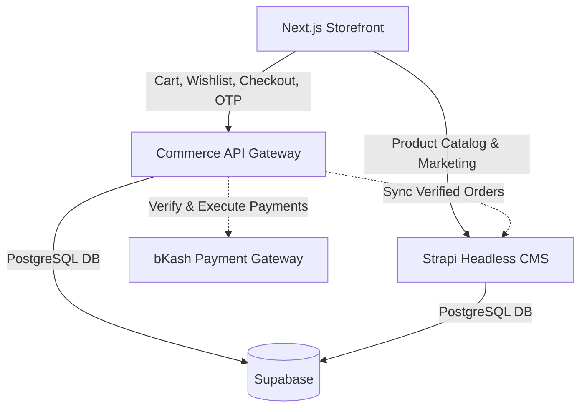

# Premium Storefront — Editorial Edition

A full-stack, headless, and CMS-driven e-commerce platform designed with a dark, premium aesthetic. This project showcases modern API design, secure payment integrations, headless content management, and aggressive server-side performance caching.

## 🚀 Tech Stack

- **Frontend:** Next.js 14, React 18, Server Components, CSS Modules (Vanilla CSS, no tailwind to maintain custom micro-animations).
- **Backend (CMS):** Strapi v4 (Headless content, Products, Blogs, Pages, Orders).
- **Backend (Gateway layer):** Express.js / Node.js (Payment processing, Wishlist caching, OTP mailing).
- **Database:** PostgreSQL (Hosted via Supabase).
- **Payments:** bKash API & Cash on Delivery.

## 🏗 Architecture

This platform utilizes a robust dual-backend setup to separate heavy content fetching from high-throughput transactional states.

## ✨ Features

- **Auth-Gated Cart & Wishlist:** Fully secure transactional architecture managed inside the Express DB layer.
- **Dynamic SEO & Indexing:** 100% automated `sitemap.xml`, `robots.txt`, open-graph tags, and canonical loops using Strapi webhooks & Next.js dynamic metadata.
- **bKash Checkout:** Manual transaction-ID submission with administrator payment verification.
- **Editorial CMS Design:** Fully customized Strapi admin styling and brand translations.
- **Scalable Filter Engine:** Query-param-mapped product sorting, search, and stock filtration that runs completely Server-Side.
- **Static Aggressive Caching:** Next.js Incremental Static Regeneration (ISR) ensures blazing fast LCP metrics, clearing caches automatically upon Strapi `publish` webhooks.

## 🔑 Environment Secrets (Keys Only)

Below are the Environment Variable keys required. **Never commit the actual values to GitHub.**

### Next.js (`frontend/.env.local`)
- `NEXT_PUBLIC_STRAPI_URL`
- `NEXT_PUBLIC_COMMERCE_API_URL`
- `COMMERCE_API_URL` (server actions; include `/api/v1`)
- `STRAPI_API_TOKEN`
- `REVALIDATION_SECRET`
- `JWT_SECRET` (shared with the Commerce API mailer proxy)

### Express Gateway (`commerce-api/.env`)
- `DATABASE_URL`
- `PORT`
- `ADMIN_API_KEY`
- `JWT_SECRET`, `JWT_REFRESH_SECRET` (required; use distinct random values)
- `STRAPI_URL`, `STRAPI_API_TOKEN`
- `STRAPI_WEBHOOK_SECRET`
- `BKASH_USERNAME`
- `BKASH_PASSWORD`
- `BKASH_APP_KEY`
- `BKASH_APP_SECRET`

### Strapi CMS (`backend/.env`)
- `HOST`, `PORT`, `APP_KEYS`, `API_TOKEN_SALT`, `ADMIN_JWT_SECRET`, `TRANSFER_TOKEN_SALT`
- `DATABASE_URL`

### Checkout and webhook deployment

Deploy the CMS schema and Commerce API migrations together with the storefront.
The Commerce API runs its idempotent migrations at startup. Existing transaction
timestamps are interpreted as UTC during the timezone migration.

Cart and order REST routes accept Strapi API tokens only, even if the Public role
has permissions enabled. Configure server-side `STRAPI_API_TOKEN` values with the
required Cart, Order and Product permissions. Never expose these tokens in browser
environment variables.

Configure Strapi product and order webhooks with the header
`Authorization: Bearer <STRAPI_WEBHOOK_SECRET>`. Product events go to
`/api/v1/sync/product`; order events go to `/api/v1/webhooks/strapi`.

COD checkout requires the email-bound, single-use token returned by
`/api/v1/otp/verify-cod`. bKash remains a **manual verification** workflow. The
legacy SSLCommerz initiation URL creates a local inventory reservation; its IPN
endpoint and reconciliation job are disabled until a real gateway validation
integration is implemented. COD confirmation does not mark an order paid.

Failed CMS order creation and stock updates are recorded in `commerce_dlq` for
operator reconciliation. Inventory keeps unsynced sales unavailable until the
CMS update is reconciled; inspect the CMS stock before retrying a decrement whose
network response was lost. After manually completing a stock decrement, reduce
the matching `pending_sync_qty` and sync the confirmed stock/version in the same
database transaction. Do not merely mark the DLQ event resolved.

The old maintenance scripts contained database and Strapi credentials. Rotate
both exposed credentials before deployment; removing them from the working tree
does not remove them from Git history. Scripts now require environment variables.

### Local regression checks

Run `npm test` in `commerce-api`. Tests use an isolated in-memory PostgreSQL
engine and mocked CMS/email calls, with no production data or credentials.
Run `npm run build` in `frontend` and `backend` for production build checks.

## 💳 Payment Architecture Security

The Commerce API calculates prices and shipping, reserves stock, and applies coupons.
COD orders require server-verified email OTPs and remain unpaid until collection.
bKash orders remain pending verification until an administrator checks the payment.
Confirmed orders are mirrored to Strapi; integration failures are retained in the DLQ.
The SSLCommerz payment callback is disabled pending a verified gateway integration.

## 🗺 Phase 4 Roadmap
- **Traffic Elasticity:** Integrate Meilisearch locally to lift searching weight off Postgres.
- **Delivery Integration:** Implement Pathao courier webhooks for realtime tracking IDs.
- **Data & Metrics:** Implement full GA4 Datalayer tracking funnel (ViewItem -> AddToCart -> Purchase).
- **Scale Testing:** Run a 1,000+ VU concurrent load-test simulating holiday peaks.
